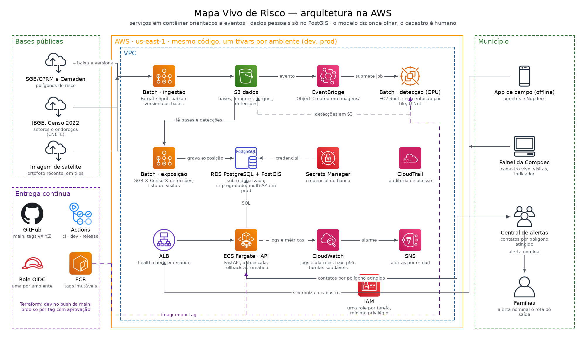

# Mapa Vivo de Risco

Cadastro vivo das famílias que moram dentro das áreas de risco de deslizamento e inundação, para a Defesa Civil
municipal: cruza os polígonos de risco do SGB/CPRM e do Cemaden com o Censo 2022 do IBGE e imagem de satélite,
detecta edificações por visão computacional, prioriza as visitas de campo e entrega o cadastro georreferenciado
para alerta e evacuação. O modelo diz onde olhar; o cadastro é humano.

Responde às metas 1.1.6 e 1.1.7 do Plano Nacional de Proteção e Defesa Civil 2025–2035 e ao dever municipal de
alerta da Lei 12.608/2012. Sistematização da disciplina Ecossistemas Digitais Inteligentes (Prof. Ricardo Neiva,
novembro de 2026); produto independente da carteira de Defesa Civil para prefeituras.

## Arquitetura na AWS



Serviços em contêiner orientados a eventos. As bases públicas entram por um job de ingestão em AWS Batch (Fargate Spot)
e ficam versionadas no S3; uma imagem nova em `imagens/` gera um evento no EventBridge que submete o job de detecção de
edificações em Batch com GPU (EC2 Spot); o job de exposição cruza polígonos do SGB, Censo 2022 e detecções no PostGIS
e produz a lista priorizada de visitas; a API em ECS Fargate, atrás de um ALB com health check, serve o app de campo
offline, o painel da Compdec e a central de alertas. Dados pessoais só no RDS, em sub-rede privada e criptografado.
A entrega é pelo GitHub Actions com OIDC: push na `main` publica em dev, tag `vX.Y.Z` com aprovação publica em prod,
tudo por Terraform com um tfvars por ambiente. O desenho é gerado por `docs/gerar_arquitetura.py` com os ícones
oficiais da AWS.

Detalhes: [docs/infra.md](docs/infra.md) (ambientes, fluxo de entrega, eventos, confiabilidade, governança),
[docs/adr/0002-branches-tags-ambientes.md](docs/adr/0002-branches-tags-ambientes.md) e `infra/terraform`.

| pasta | serviço | estado |
|---|---|---|
| `servicos/ingestao` | baixa e versiona SGB, Cemaden, Censo 2022 (setores e CNEFE) e imagens | esqueleto |
| `servicos/exposicao` | cruzamento geométrico e estimativa por setor de risco (método BATER com Censo 2022) | esqueleto |
| `servicos/deteccao` | inferência de segmentação de edificações sobre tiles dentro dos polígonos | esqueleto |
| `servicos/api` | cadastro de famílias, lista de visitas, contatos por polígono | `GET /saude` |
| `app` | aplicativo de campo offline (Expo) | planejado |
| `painel` | painel da Compdec | planejado |
| `infra` | Docker Compose local (PostGIS + API); Terraform com módulos rede, dados, registro, serviços, lote, observabilidade e cicd, ambientes dev e prod | validado, não aplicado |

Documentos: [docs/plano-sistematizacao.md](docs/plano-sistematizacao.md), [docs/artigos-indice.md](docs/artigos-indice.md),
decisões em [docs/adr](docs/adr).

## Entrega

| gatilho | ambiente | workflow |
|---|---|---|
| PR | nenhum | `ci` (lint, testes, build) e `terraform-plan` (comenta o plan de dev) |
| push na `main` | dev | `deploy-dev`: imagens `sha-<7>` → `terraform apply` → fumaça em `/saude` |
| tag `vX.Y.Z` | prod | `release`: imagens `vX.Y.Z` → plan → aprovação manual → apply → release no GitHub |

## Rodar local

```bash
docker compose -f infra/docker-compose.yml up --build
curl http://localhost:8000/saude
```
